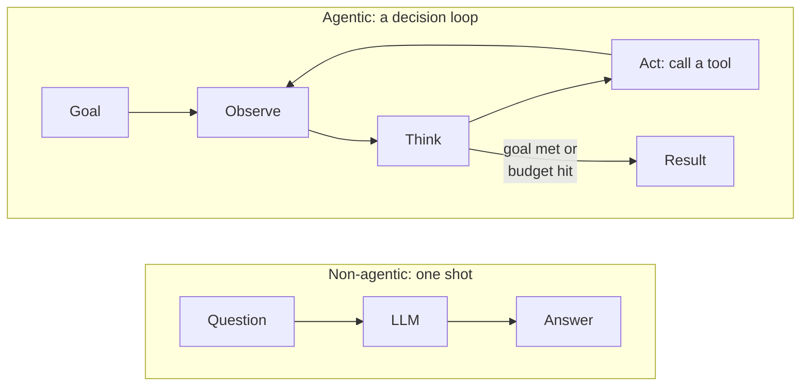
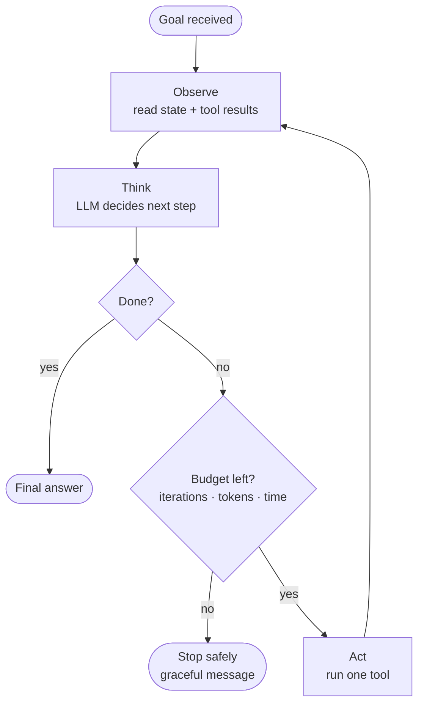
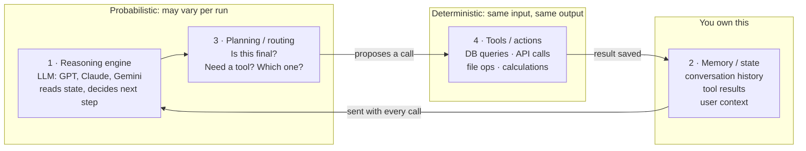
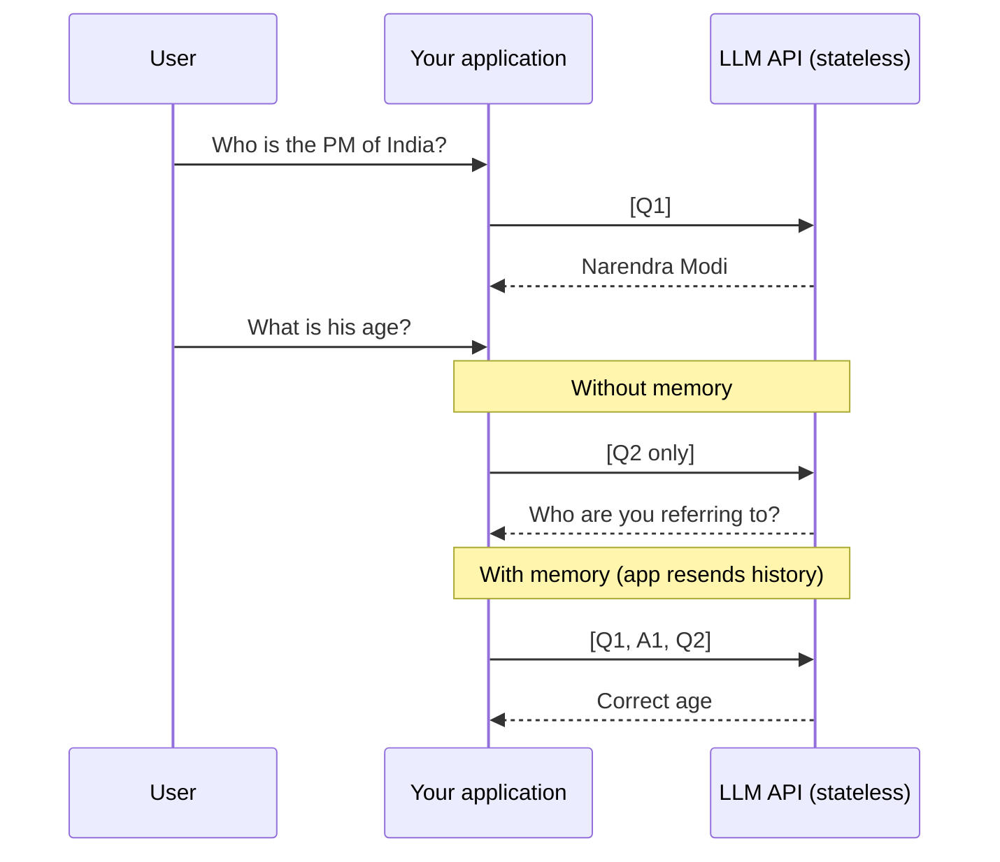
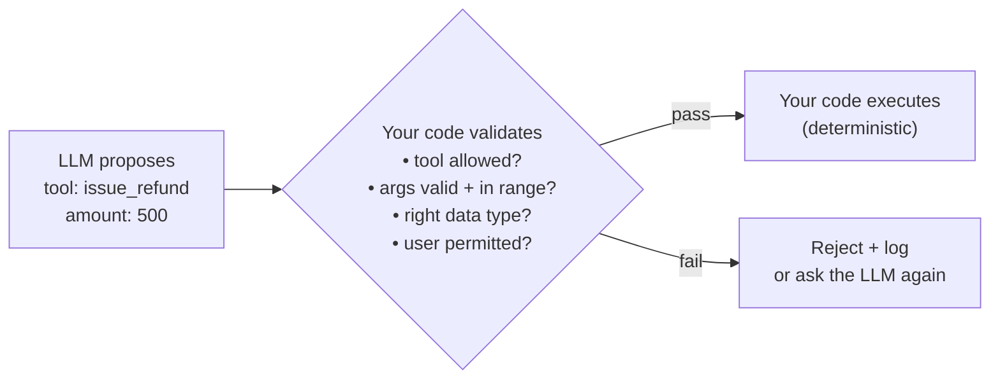

# Week 1 · Session 1 — Theory: The Agent Mental Model

> **Source:** Manifold AI Learning, Agentic AI Enterprise Mastery Bootcamp, Week 1 Session 1 (live recording 00:29 → 01:51).
> **Status:** Private study notes. Ideas in my own words; do not reuse Manifold's slides or wording in the course.

**The one-line summary:** an agent is an LLM inside a loop that *you* control. Every production concern in this bootcamp exists to keep that loop safe, bounded and explainable.

---

## 1. Agentic vs non-agentic

| | Non-agentic | Agentic |
|---|---|---|
| Input | A question | A goal |
| Steps | One, fixed | Many, decided at runtime |
| Tool calls | None or one | Several, chosen by the model |
| Ends when | The answer is returned | Goal met, or a termination condition fires |
| Example | "Summarise this log file" | "Analyse Q4 sales" (pull data → spot anomaly → compare history → fix → report) |
| DBA example | "Explain this EXPLAIN plan" | "Why did p99 latency jump at 10:00?" |

**Key point from the session:** an agent is not "an LLM call". It is a **decision loop**. In the Q4 sales example the user made *one* request; the agent made *four* decisions.

---

## 2. The agent loop: where production risk begins

The loop is **observe → think → act → repeat**, until the task completes or a **termination condition** stops it.

Every pass is a fresh decision, and each one can be wrong. Errors **compound**: a hallucinated result in step 2 poisons steps 3 to 10.

> **Key insight:** production agents are hard not because the tools are complex, but because **managing the loop** is complex.

### The 7 production risks of the loop

| Risk | What it means | Generic example | DBA example |
|---|---|---|---|
| Wrong tool call | Model picks the wrong function or arguments | Refund API instead of status API | Runs `VACUUM FULL` instead of reading `pg_stat_user_tables` |
| Infinite loop | Never reaches "done" | Re-searches the same thing forever | Re-polls `pg_stat_activity` waiting for a lock to clear |
| Cost explosion | Token usage grows without limit | Whole PDF re-sent every step | 50 MB `postgresql.log` pasted into every call |
| Bad memory | Wrong, stale or missing context | Forgets the customer's order ID | Forgets which PID it already identified |
| No audit trail | Can't explain what happened | No record of why a refund was issued | Nobody knows why a backend was killed at 2 AM |
| Unsafe action | Destructive step without checks | Deletes a customer record | `pg_terminate_backend` on a walsender |
| Slow response | User waits too long | Tool hangs on a slow API | Diagnostic query stuck behind the same lock |

Participants also named **context poisoning**, **hallucination** and **output-token explosion**; these are sub-cases of the list above.

---

## 3. Anatomy of an agentic system (the 80% slide)

Understanding these four parts covers most of what the bootcamp builds over 8 weeks.

| # | Component | Job | Nature | Who owns it |
|---|---|---|---|---|
| 1 | Reasoning engine | Reads state, decides what's next | Probabilistic | Model vendor |
| 2 | Memory / state | Holds history, tool results, user context | Data | **You (the application)** |
| 3 | Planning / routing | Final answer or tool call? Which tool? | Probabilistic decision | You design it, LLM fills it |
| 4 | Tools / actions | DB calls, APIs, files, functions | Deterministic | **You** |

When the instructor says "agent", he means all four together, not just the LLM.

---

## 4. LLMs are stateless: the application owns memory

Every API call starts from zero. The model remembers nothing between calls.

- **GPT-5.5 API** → no memory. **ChatGPT** (the app built on it) → has memory, because OpenAI's *application* stores and resends it.
- **Claude Opus API** → no memory. **Claude.ai** (the app) → has conversation and user memory, added by the application.
- When you build a business app, you use the **API**, so **you** must supply memory.
- KV caching does not change this. Caching is a speed/cost optimisation; the model is still stateless. (Covered later in the bootcamp.)

Without memory, the LLM is "a person with amnesia". The fix is the **messages list**, built in the next session.

---

## 5. Termination conditions and loop protection

A termination condition stops the loop even if the goal is not met.

| Condition | Protects against |
|---|---|
| Max iterations | Infinite loops |
| Cost / token budget | Cost explosion |
| Time limit | Slow response |

- A confused model on a vague task can loop **50, 100 or 500 times**. Each pass is a paid API call.
- **LangChain** exposes a max-iterations parameter. **LangGraph** makes you design the stop condition into the graph.
- Suggested starting range: **5 to 10 iterations**, tuned to task complexity.
- If the agent can't solve it in 10 steps, step 11 is unlikely to help. Stop and degrade gracefully.

---

## 6. LLM proposes, code disposes

The core safety rule, repeated throughout the bootcamp.

- **Proposal** = probabilistic. The model might say $5,000 when it meant $500.
- **Execution** = deterministic, and always owned by your code.
- The LLM never touches the database, payment API or file system directly.

---

## 7. Production-readiness checklist

Every agent should pass these before production. The bootcamp builds each item by Week 4; by Week 8 they should be second nature.

| # | Check | The question it answers |
|---|---|---|
| 1 | Error handling | What happens when the LLM call fails? |
| 2 | Structured logging | Can a half-asleep on-call engineer trace what happened at 2 AM? |
| 3 | Loop protection | Is a max iteration count set? |
| 4 | Cost tracking | Do you know what each session costs? |
| 5 | Secrets management | Are keys in `.env`, never in code or git history? |
| 6 | Graceful degradation | If a tool or model fails, do you crash or recover? |
| 7 | Input validation | Can a crafted prompt break the agent? |
| 8 | Timeout handling | Does every external call have a timeout? |

**Session 1 deliverables announced** (to be built next session): working LangChain setup, a customer-support conversation agent, error handling around LLM calls, structured logs with latency and token usage, and a short write-up on why it is more production-aware than a chatbot demo.

---

## 8. Insights from the Q&A

**Securing an agent: two rules cover about 90% of the risk**
1. The agent must never make a tool call it is not authorised for (controlled by a policy document, covered later).
2. A user must never gain extra permissions just because they can talk to the agent. Check the *user's* permission before every external call.

**Graceful degradation**
When the model API is down or rate-limited, don't show a raw technical error. Either fall back to another provider (OpenAI down → try Gemini) or show a clean static message ("We've received your request and will get back to you").

**Rules vs LLM: when to use which**
- If the task can be written as reliable rules (fetch → validate → extract → call function), **use rules**: predictable, and when they fail you know exactly which rule failed.
- Use the LLM where rules break: messy natural language. Example: "I want to go to Bengaluru tmrw" (with typos) → LLM normalises it to `{city: "Bangalore", date: "2026-06-07"}` → deterministic function does the booking.
- Pattern: **LLM interprets, code executes.**

**Detecting hallucination** (covered properly under evals)
- Keep a **golden dataset** of known-correct answers and test against it.
- **Validate** every tool call and its arguments; hallucinations show up first in tool calling.

**Pin library versions** in `requirements.txt` for deployment. The class skipped this for learning convenience.

---

## 9. Requirements: every package and why

Session 1 itself needs only four: `langchain`, `langchain-openai`, `langchain-google-genai`, `python-dotenv`. The class shared one `requirements.txt` for the whole bootcamp, so you install everything once. "Used in" is my best guess from the syllabus; confirm as the weeks go.

### Core LLM and agent frameworks

| Requirement | Why it's needed | Used in |
|---|---|---|
| `langchain` | Main framework: chains, prompts, tool calling | All weeks |
| `langchain-core` | Base classes (messages, runnables) every LangChain package builds on | All weeks |
| `langchain-community` | Community integrations (loaders, vector stores, tools) | RAG, tools |
| `langchain-text-splitters` | Splits long documents into chunks for RAG | RAG |
| `langchain-openai` | Connects LangChain to OpenAI models (`ChatOpenAI`) | Session 1 onwards |
| `langchain-google-genai` | Connects LangChain to Gemini (`ChatGoogleGenerativeAI`) | Session 1 onwards |
| `langgraph` | Builds agents as graphs with state, loops and checkpoints | Week 1 harness onwards |
| `langgraph-checkpoint-sqlite` | Saves agent state to SQLite for pause/resume | Week 1–2 |
| `langchain-postgres` | PostgreSQL integration: vector store, chat history | Week 2 memory, RAG |
| `openai` | Official OpenAI SDK (direct calls, embeddings) | Embeddings, direct API |
| `mcp` | Model Context Protocol SDK: expose tools to agents | Week 3 |
| `langserve` | Serves LangChain chains as REST APIs | Week 4 |

### Data, validation and utilities

| Requirement | Why it's needed | Used in |
|---|---|---|
| `python-dotenv` | Loads API keys from `.env` into environment variables | Session 1 onwards |
| `pydantic` | Typed models and validation for state and tool arguments | Week 1 typed state |
| `numpy` | Numeric arrays, used under embeddings and scoring | RAG, evals |
| `requests` | Plain HTTP calls to external APIs | Tools |
| `tiktoken` | Counts tokens before sending, for budgets and cost | Cost tracking |
| `tqdm` | Progress bars for long batch jobs | Ingestion, evals |
| `colorama` | Coloured terminal output for readable demos | Demos |

### Storage and databases

| Requirement | Why it's needed | Used in |
|---|---|---|
| `redis` | Fast short-term memory, caching, Celery broker | Week 2, Week 4 |
| `psycopg[binary]` | Modern PostgreSQL driver (psycopg 3) | Memory, RAG |
| `psycopg2-binary` | Older PostgreSQL driver; some libraries still need it | Compatibility |
| `pgvector` | Python support for PostgreSQL's vector type | RAG on PostgreSQL |

### Retrieval and search

| Requirement | Why it's needed | Used in |
|---|---|---|
| `rank-bm25` | Keyword (BM25) search, combined with vectors for hybrid search | Advanced RAG |
| `sentence-transformers` | Local embedding and reranking models | RAG, reranking |
| `scikit-learn` | ML utilities, t-SNE for visualising embeddings | Embeddings demo |
| `matplotlib` | Plots, e.g. the embeddings visualisation | Embeddings demo |
| `duckduckgo-search` | Free web-search tool for agents | Tool examples |
| `arxiv` | Fetches research papers as a tool | Tool examples |

### Document processing

| Requirement | Why it's needed | Used in |
|---|---|---|
| `pypdf` / `PyPDF2` | Read text from PDFs (PyPDF2 is the older name) | RAG ingestion |
| `pdfplumber` | Better PDF extraction, including tables | RAG ingestion |
| `pdf2image` | Converts PDF pages to images for OCR (needs `poppler`) | OCR |
| `pytesseract` | OCR on scanned docs (needs the Tesseract binary) | OCR |
| `python-magic` | Detects real file type from content, not extension | Ingestion safety |
| `lxml` / `beautifulsoup4` | Parse HTML and XML | Web loaders |
| `python-docx` | Read and write Word files | Reports |
| `reportlab` | Generate PDF reports | Reports |

### Service layer and deployment

| Requirement | Why it's needed | Used in |
|---|---|---|
| `fastapi` | Web API framework to expose the agent as a service | Week 4 |
| `uvicorn[standard]` | ASGI server that runs FastAPI | Week 4 |
| `sse-starlette` | Server-sent events for streaming responses | Week 4 |
| `celery[redis]` | Background job queue for long agent runs | Week 4 |
| `boto3` | AWS SDK | Week 6 deploy |
| `watchtower` | Sends Python logs to AWS CloudWatch | Week 6 observability |

### Testing and code quality

| Requirement | Why it's needed | Used in |
|---|---|---|
| `pytest` | Test runner | Week 5 evals onwards |
| `pytest-asyncio` | Tests for async code | Week 4–5 |
| `pytest-mock` | Mocks LLM and tool calls in tests | Week 5 |
| `pytest-cov` | Test coverage reports | Week 5–6 |
| `black` | Auto-formats code | Dev hygiene |
| `flake8` | Linting | Dev hygiene |
| `mypy` | Static type checking | Typed state |

**System packages (not pip):** Tesseract OCR and Poppler. macOS: `brew install tesseract poppler`. Ubuntu: `apt-get install tesseract-ocr poppler-utils`. Windows: installers from GitHub.

**Noticed duplicates:** `langchain-community` and `langchain_community` are the same package; `pypdf` and `PyPDF2` overlap; `rank-bm25` and `openai` appear twice. Harmless, but worth cleaning before pinning versions.

---

## 10. Jargon

| Term | Plain meaning | PostgreSQL analogy |
|---|---|---|
| LLM | Large language model; predicts text from text | The planner: a best guess from statistics, not a guarantee |
| Agent | LLM in a loop that picks and runs tools toward a goal | A DBA working an incident, not one query |
| Agentic system | LLM + memory + routing + tools together | A full HA stack, not just the `postgres` binary |
| Decision loop / agent loop | Observe → think → act, repeated | A DBA's diagnose → check → act cycle |
| Termination condition | Rule that ends the loop (iterations, cost, time) | `statement_timeout` for the loop |
| Max iterations | Hard cap on loop passes | `max_connections`: a ceiling that protects the system |
| Stateless | Each call knows nothing of earlier calls | A transaction-pooled PgBouncer connection: `SET` and temp tables don't survive |
| Memory / state | History and facts the app resends each call | Session state you must restore yourself |
| Context | Everything sent to the model in one call | Query text plus bind parameters |
| Context window | Max tokens per call | `work_mem`: a hard size limit |
| Token | Unit of text the model reads and bills by (~¾ word) | A buffer page: the unit you count and pay for |
| `usage_metadata` | Input/output/total tokens of a call | `shared_blks_hit/read` in `EXPLAIN (BUFFERS)` |
| Temperature | Output randomness; 0 = most repeatable | Low = same plan every time |
| `max_tokens` | Cap on response length | `LIMIT` on the answer |
| Reasoning engine | LLM part that decides the next step | The optimizer choosing the next node |
| Planning / routing | Answer now, or call a tool? Which? | Executor choosing between plan nodes |
| Tool / action | Deterministic function the agent may call | A `SECURITY DEFINER` function with a fixed contract |
| Probabilistic vs deterministic | May vary per run vs always same output | Estimated rows vs actual rows |
| Propose / dispose | LLM suggests, code validates and executes | Developer submits a migration; DBA reviews and applies |
| Hallucination | Confident but false output | A plan built on stale statistics |
| Context poisoning | A wrong fact in history corrupting later steps | A bad write replicated to every standby |
| Graceful degradation | Clean fallback instead of a crash | Patroni failover instead of an outage |
| Golden dataset | Known-correct Q&A pairs to test against | A regression suite like `make check` |
| `.env` | File of secrets loaded at runtime, never committed | `.pgpass` |
| Virtual environment | Isolated Python packages per project | A separate cluster per major version |
| KV caching | Reuses computed attention for repeated prompt prefixes; speed/cost only | Shared buffers: faster, but no new knowledge |
| LangChain | Framework wrapping LLM providers, prompts, tools | A driver layer like psycopg over many backends |
| LangGraph | Framework for agents as stateful graphs | A state machine with checkpoints, like WAL + recovery |
| `invoke()` | Send one request, get one response | One `PQexec()` round trip |
