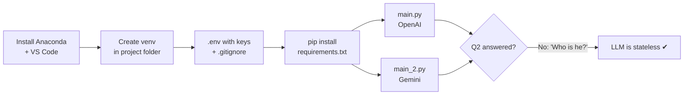

# Week 1 · Session 1 — Original Lab: First LLM Call and the Stateless Proof

> **Source:** Manifold Week 1 Session 1, hands-on part (≈ 01:07 → 01:37).
> **Status:** Private study notes. This is Manifold's lab, recapped for revision. Not for reuse in the course.

**Goal:** set up a clean Python environment, store API keys safely, make a first LLM call through LangChain, and prove that two calls share no memory.



---

## Step 0 — Tools

| Tool | Notes |
|---|---|
| Anaconda | Recommended. `venv` or `uv` are fine if you're comfortable with them |
| IDE | VS Code (free) or Cursor |
| Windows terminal | Use **Anaconda Prompt**, not PowerShell or Anaconda PowerShell |
| Mac terminal | Terminal |
| Folder location (Windows) | Under `C:\Users\<you>\…` to avoid paths with spaces |

Terminal command differences (the instructor shared a cheat sheet):

| Task | Mac / Linux | Windows |
|---|---|---|
| List files | `ls` | `dir` |
| Current directory | `pwd` | `cd` |

---

## Step 1 — Virtual environment

**Conda (shown in class).** Creates the env *inside* the project folder, so cleanup = delete the folder.

```bash
conda create --prefix ./env python=3.12
conda activate ./env
pip install -r requirements.txt
```

**venv alternative (from the slide):**

```bash
python -m venv venv
source venv/bin/activate          # Windows: venv\Scripts\activate
pip install langchain langchain-openai langchain-google-genai python-dotenv
python -c "import langchain; print(langchain.__version__)"   # verify
```

The full `requirements.txt` takes a while: it installs everything needed for all 8 weeks. See the table in `01_theory.md`, section 9.

---

## Step 2 — Secrets: `.env` and `.gitignore`

`.env` in the project root:

```bash
OPENAI_API_KEY=sk-your-key
GOOGLE_API_KEY=your-key
```

Also create `.env.example` with placeholder values, so anyone cloning the project knows which variables are needed.

`.gitignore`, created **immediately**:

```gitignore
.env
venv/
__pycache__/
*.pyc
```

> Leaked keys are found by bots within minutes. `.gitignore` is security hygiene, every project, every time.

---

## Step 3 — Get API keys

**Google Gemini (free, rate-limited)**
1. Go to `aistudio.google.com`.
2. **Get API key** → **Create API key**.
3. Give it a name (e.g. "cohort five API key"), pick or create a project.
4. Copy the key into `GOOGLE_API_KEY`.

**OpenAI (paid, no practical rate limit for this course)**
1. Go to `platform.openai.com` (not chatgpt.com).
2. **Settings → Billing** → add a payment method and at least **$5 credit**. About $5 should last the whole bootcamp.
3. **API keys → Create new secret key** → name it, pick the default project.
4. Copy the key into `OPENAI_API_KEY`.

> A ChatGPT Plus or Pro subscription does **not** cover API usage. The API platform is billed separately.

---

## Step 4 — `main.py` (OpenAI)

```python
from dotenv import load_dotenv
from langchain_openai import ChatOpenAI
load_dotenv()

llm = ChatOpenAI(model="gpt-4o-mini", temperature=1, max_tokens=150)

# Q1
r1 = llm.invoke("Who is the Prime Minister of India?")
print(r1.content)

# Q2 — the follow-up that breaks
r2 = llm.invoke("What is his age?")
print(r2.content)          # "Who are you referring to?"

print(r1.usage_metadata)
```

| Line | What it does |
|---|---|
| `load_dotenv()` | Reads `.env` into environment variables; `ChatOpenAI` finds `OPENAI_API_KEY` automatically |
| `ChatOpenAI(...)` | Creates the model client. `temperature=1` = more varied output; `max_tokens=150` caps answer length |
| `llm.invoke(...)` | One request, one response |
| `.content` | The text of the reply |
| `.usage_metadata` | Token counts: input, output, total. The basis of cost tracking |

Run: `python main.py`

## Step 5 — `main_2.py` (Gemini)

Only two lines change: the import and the class.

```python
from dotenv import load_dotenv
from langchain_google_genai import ChatGoogleGenerativeAI
load_dotenv()

llm = ChatGoogleGenerativeAI(model="gemini-3.5-flash")

r1 = llm.invoke("Who is the Prime Minister of India?")
print(r1.content)

r2 = llm.invoke("What is his age?")
print(r2.content)          # "Who are you referring to?"

print(r1.usage_metadata)
```

Available model names are listed in AI Studio (e.g. Gemini 3.5 Flash, 3.1 Flash-Lite, 3 Flash).

Run: `python main_2.py`

---

## What you should observe

| Observation | Lesson |
|---|---|
| `gpt-4o-mini` said "as of my last update in October 2023" | Older models have older knowledge. Model choice matters |
| Switching to `gpt-5.5` gave the current answer | Same code, different model, different freshness |
| Both providers answered Q1 correctly | Setup works |
| Both providers failed Q2 ("who do you mean?") | **LLMs are stateless.** The second call never saw the first |
| Failure wording differed by provider | Providers phrase things differently; the behaviour is identical |

**Why it matters:** even the latest model behind ChatGPT has no memory through the API. Your application must send the history. That is the next session.

---

## Common issues

| Problem | Likely fix |
|---|---|
| `AuthenticationError` | Key missing from `.env`, or `load_dotenv()` not called before creating the model |
| OpenAI `insufficient_quota` | No billing credit on platform.openai.com |
| Gemini `429` | Free-tier rate limit. Wait, or switch to OpenAI |
| `ModuleNotFoundError` | Env not activated. Run `conda activate ./env` again |
| Commands fail on Windows | You're in PowerShell, not Anaconda Prompt |
